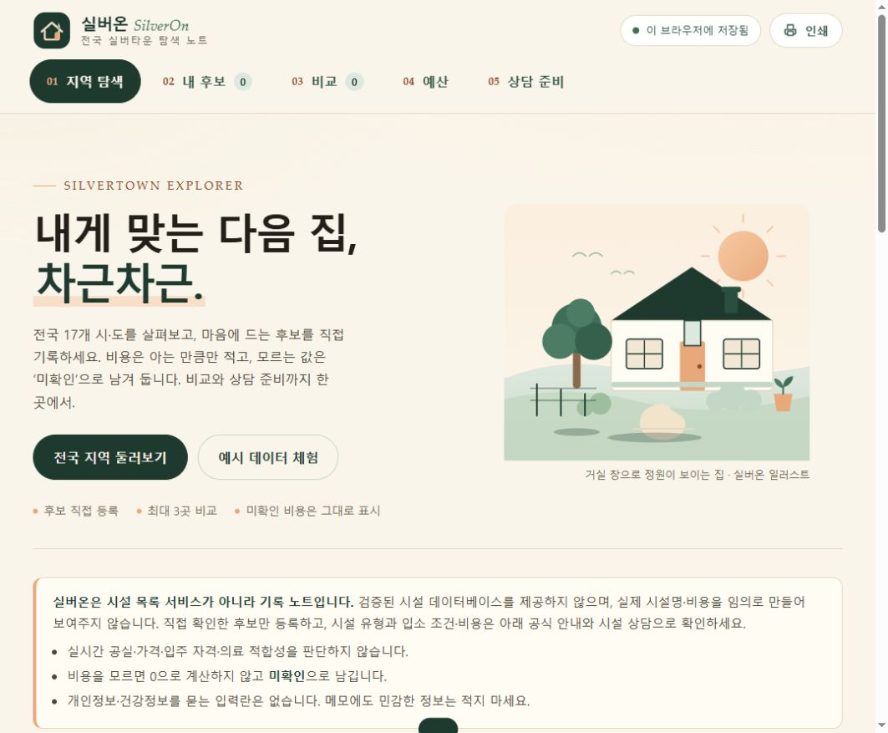

# 실버온 SilverOn

**내게 맞는 다음 집, 차근차근.**

전국의 실버타운을 알아보며 직접 확인한 후보를 정리하고 비교하는 수업용 정적웹앱입니다.
전국 시설 데이터베이스나 실시간 가격·공실 정보 서비스는 제공하지 않습니다.

## 프로젝트 링크

- [소스 저장소](https://github.com/junhyeok9679-arch/first-static-webapp)
- [앱 실행](https://junhyeok9679-arch.github.io/first-static-webapp/)
- [NotebookLM 아이디어·발표자료](https://notebook.google.com/notebook/b2444d0b-8e0d-41c7-8f90-854d05af4925)
- [Genspark 코드 생성 작업](https://www.genspark.ai/agents?id=f19400ab-3af8-409a-8bab-18adb597d748)

## 주요 기능

- 17개 시도별 탐색과 외부 검색 연결
- 직접 확인한 시설 후보 등록·수정 및 관심 목록
- 최대 3개 후보 비교
- 사용자 입력값을 바탕으로 월·연간 지출 정리, 보증금 별도 표시
- 상담 질문 체크리스트와 메모
- 브라우저 저장과 JSON 백업

가상 체험 자료는 실제 시설과 구분해 표시합니다. 미확인 비용은 0원이나 무료를 의미하지 않습니다.

## 실행

`index.html`을 브라우저에서 열거나 VS Code에서 우클릭 → **Open with Live Server**를 선택합니다.
HTML·CSS·JavaScript를 사용하는 정적웹앱이며 서버 계정이나 API 키가 필요하지 않습니다.

## 수업 작업 흐름

1. NotebookLM: 보건복지부 공식 안내를 읽고 제품 아이디어 수집
2. 발표자료: 사용자 요청에 따라 Gamma 대신 NotebookLM으로 생성, 13장 원고로 확장
3. 아이디어 공유: 사용자가 승인한 NotebookLM 링크 열람 공유
4. Genspark: 실제 정적웹앱 코드 생성
5. Codex: 코드 검수, VS Code 실행 연결, GitHub 게시와 캡처

## 정보 출처와 범위

- [보건복지부 노인주거복지시설 안내](https://www.mohw.go.kr/menu.es?mid=a10712010500): NotebookLM에서 실제 분석한 공식 자료
- [마이홈](https://www.myhome.go.kr/): 추가 정보 확인 링크. NotebookLM 자동 가져오기가 실패하여 분석 근거에서는 제외

시설 유형과 입주 조건은 공식 안내 및 해당 시설에서 확인해야 합니다. 앱은 입주 자격·의료 필요성을 판정하거나 시설 계약을 알선하지 않습니다.
저장 정보는 브라우저별로 유지되며 기기 간 자동 동기화되지 않습니다. JSON 내보내기로 백업하세요.

## 발표자료와 실행 화면

[13장 발표자료 다운로드](실버온_전국실버타운_13장_발표용.pptx)

